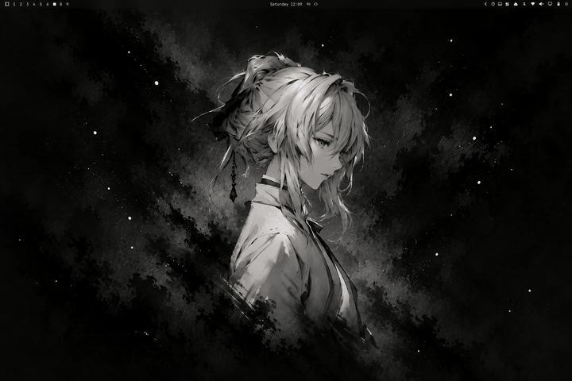

# Uniarchy Lock Screen

Минималистичный экран блокировки для Omarchy: чёткие обои с лёгким затемнением,
крупные часы, приветствие по времени суток и стеклянное поле пароля. Цвета
берутся из `[lock]` текущей темы, шрифт — системный моноширинный.
При блокировке окна разъезжаются, при разблокировке экран растворяется
в живом рабочем столе. MIT, DmitryUniversall.


<p align="center">
  
</p>

## Возможности

### Блокировка


Перед блокировкой снимается снимок экрана. Бар уезжает вверх, каждое окно
вырезается по своим границам (с рамкой и скруглением) и уплывает от центра
экрана: левое — влево, правое — вправо. Обои остаются на месте и только
затемняются, затем по очереди проявляются часы, приветствие и поле пароля.
На пустом рабочем столе уезжает только бар, полноэкранное окно улетает целиком.

### Always-on


Через 30 секунд без активности всё, кроме часов, даты и заряда, плавно гаснет,
часы приглушаются и съезжают в центр, а подсветка встроенного дисплея
опускается до 15%. Через 2 минуты экран выключается. Любое движение мыши или
нажатие клавиши возвращает обычный вид и прежнюю яркость.

### Разблокировка


После верного пароля или отпечатка значок сканера сменяется галочкой,
содержимое поднимается и гаснет, а экран растворяется, показывая живой рабочий
стол. Сессия остаётся заблокированной до конца анимации (около полсекунды).

### Остальное

- **Раскладка и Caps Lock** — метка `en`/`ru` слева в поле пароля, под полем
  предупреждение `caps lock`.
- **Сканер отпечатка** — значок «дышит», пока сканер ждёт палец, краснеет
  с подписью `not recognized` при несовпадении.
- **Батарея** — горизонтальный индикатор с процентами под датой: голубой
  на зарядке, красный при 10% и ниже.
- **Кнопки питания** — сон, перезагрузка и выключение в правом нижнем углу.
  Перезагрузка и выключение просят второй клик в течение 3 секунд.

Вход по паролю и отпечатку работает через те же PAM-профили, что и штатный
экран блокировки (`omarchy-lock-password`, `omarchy-lock-fingerprint`).

## Установка

Плагин — клон встроенного `omarchy.lock` (`clonedFrom` в манифесте), поэтому
получает от него право на аутентификацию. Зависимости штатные для Omarchy:
`grim`, `jq`, `brightnessctl`.

1. Установите плагин из git (или положите папку в
   `~/.config/omarchy/plugins/uniarchy.lock`), затем включите его
   и выключите штатный экран блокировки:

   ```sh
   omarchy plugin add https://github.com/DmitryUniversall/uniarchy-lock
   omarchy plugin enable uniarchy.lock
   omarchy plugin disable omarchy.lock
   omarchy restart shell
   ```

2. Для анимации разблокировки Hyprland должен рисовать рабочий стол под
   прозрачным экраном блокировки. В `~/.config/hypr/looknfeel.lua`, в `misc`:

   ```lua
   misc = {
     session_lock_xray = true,
   },
   ```

   Затем `hyprctl reload` и `hyprctl configerrors`. Без этой опции экран
   при разблокировке растворится в чёрный.

Сервис блокировки не перезагружается на лету: после правки кода плагина нужен
`omarchy restart shell`. Вернуть штатный экран: `omarchy plugin remove uniarchy.lock`.

## Настройки

Настройки хранятся прямо в записи плагина в `~/.config/omarchy/shell.json`
и применяются сразу после сохранения файла:

```json
{
  "id": "uniarchy.lock",
  "clockFormat": "HH:mm",
  "dateFormat": "dddd, d MMMM",
  "greeting": true,
  "showUser": true,
  "dim": 0.22,
  "animations": true,
  "keyboardLayout": true,
  "battery": true,
  "powerButtons": true,
  "alwaysOnAfter": 30,
  "alwaysOnBrightness": 15,
  "screenOffAfter": 120
}
```

| Ключ | По умолчанию | Что делает |
|---|---|---|
| `clockFormat` | `"HH:mm"` | формат часов; `"h:mm AP"` — 12-часовой |
| `dateFormat` | `"dddd, d MMMM"` | формат даты (английская локаль) |
| `greeting` | `true` | приветствие по времени суток |
| `showUser` | `true` | логин под приветствием |
| `dim` | `0.22` | сила затемнения обоев, от 0 до 1 |
| `animations` | `true` | `false` — без снимка экрана и без анимаций |
| `keyboardLayout` | `true` | метка раскладки в поле пароля |
| `battery` | `true` | индикатор заряда |
| `powerButtons` | `true` | кнопки питания |
| `alwaysOnAfter` | `30` | секунд до режима always-on; `0` — выключен |
| `alwaysOnBrightness` | `15` | яркость подсветки в always-on, %; `0` — не менять |
| `screenOffAfter` | `120` | секунд до выключения экрана; `0` — не выключать |

Таймеры считаются от последнего действия на экране блокировки.

## IPC и проверки

Превью открывается поверх рабочего стола без настоящей блокировки и
закрывается кликом:

```sh
omarchy-shell lock preview          # превью с анимацией блокировки
omarchy-shell lock previewAmbient   # включить/выключить always-on в превью
omarchy-shell lock previewUnlock    # анимация разблокировки, затем закрыть превью
omarchy-shell lock hidePreview
omarchy-shell lock status           # состояние, раскладка и текущие настройки
omarchy system lock                 # настоящая блокировка
```

## Механизм и ограничения

- Снимок делает `snapshot.sh`: `grim` по каждому монитору (около 50 мс) плюс
  геометрия видимых окон из `hyprctl clients`. Файлы лежат в
  `$XDG_RUNTIME_DIR/omarchy-lock-snapshot/`, доступны только пользователю
  и удаляются после разблокировки. Снимок укладывается в штатную паузу
  в 500 мс перед блокировкой; если он завис, блокировка наступает не позже
  чем через 1,5 секунды.
- Рабочий стол виден сквозь экран блокировки только во время анимации после
  успешного входа и, если снимок не удался, в первые 0,6 секунды блокировки.
- Плавающее окно поверх обычного попадает в вырезку обоих и улетает дважды.
- Если shell перезапустится в режиме always-on, подсветка останется на
  пониженной яркости.
- В превью кнопки питания ничего не делают.
