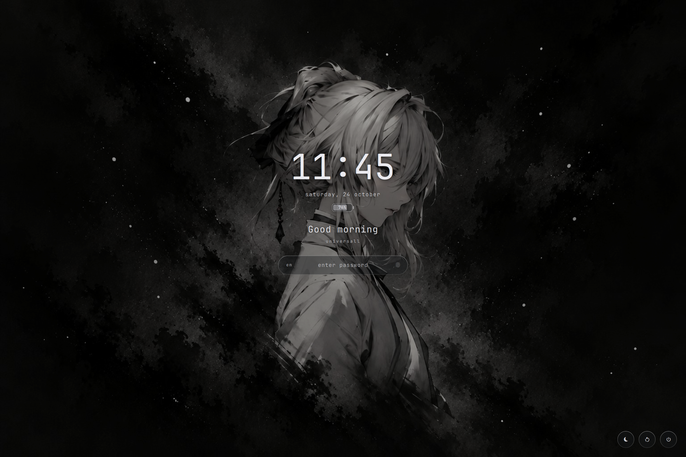
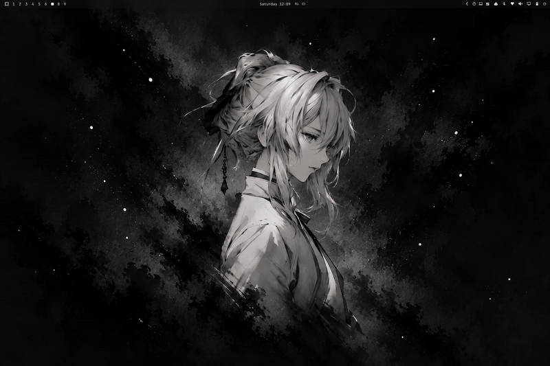
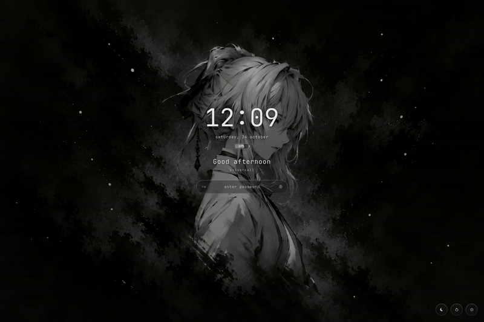
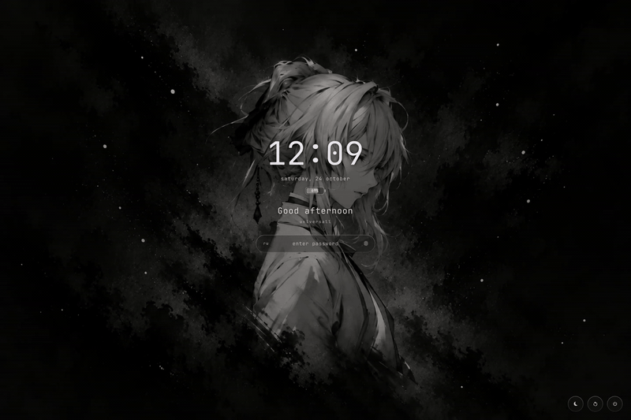

# Uniarchy Lock Screen

A minimal glass lock screen for Omarchy: crisp dimmed wallpaper, a big clock,
a time-of-day greeting and a translucent password field in your theme's colors.



| Lock | Always-on | Unlock |
|---|---|---|
|  |  |  |

## Features

- **Lock animation**: the bar slides up and windows drift apart, while the wallpaper stays put.
- **Unlock animation**: the screen dissolves into the live desktop.
- **Always-on**: after a short idle, only a dimmed clock stays and the backlight drops. Later the screen turns off.
- **Password field**: keyboard layout, Caps Lock warning and fingerprint status.
- **Battery** indicator under the date.
- **Power buttons**: sleep, restart and shut down. Restart and shut down need a second click.

## Install

```sh
omarchy plugin add https://github.com/DmitryUniversall/uniarchy-lock
omarchy plugin enable uniarchy.lock
omarchy plugin disable omarchy.lock
omarchy restart shell
```

For the unlock fade, add this to `misc` in `~/.config/hypr/looknfeel.lua`, then run `hyprctl reload`:

```lua
session_lock_xray = true,
```

To go back to the stock lock screen, run `omarchy plugin remove uniarchy.lock`.

## Settings

Settings go on the plugin's entry in `~/.config/omarchy/shell.json` and apply on save:

```json
{
  "id": "uniarchy.lock",
  "clockFormat": "HH:mm",
  "dateFormat": "dddd, d MMMM",
  "greeting": true,
  "showUser": true,
  "dim": 0.22,
  "animations": true,
  "keyboardLayout": true,
  "battery": true,
  "powerButtons": true,
  "alwaysOnAfter": 30,
  "alwaysOnBrightness": 15,
  "screenOffAfter": 120
}
```

| Key | Description |
|---|---|
| `clockFormat`, `dateFormat` | Qt time and date formats; use `"h:mm AP"` for a 12-hour clock |
| `greeting`, `showUser` | show the greeting and the username |
| `dim` | wallpaper dimming, from 0 to 1 |
| `animations` | `false` turns off all animations |
| `keyboardLayout`, `battery`, `powerButtons` | show or hide each element |
| `alwaysOnAfter` | idle seconds before always-on; `0` disables it |
| `alwaysOnBrightness` | backlight % in always-on; `0` leaves it unchanged |
| `screenOffAfter` | idle seconds before the screen turns off; `0` never turns it off |

## Preview

```sh
omarchy-shell lock preview          # click to close
omarchy-shell lock previewAmbient   # toggle always-on
omarchy-shell lock previewUnlock    # play the unlock animation
```

## License

MIT, DmitryUniversall
